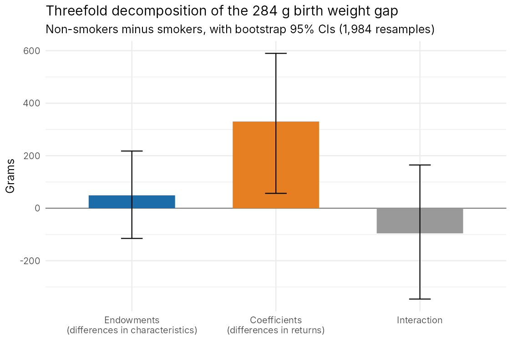
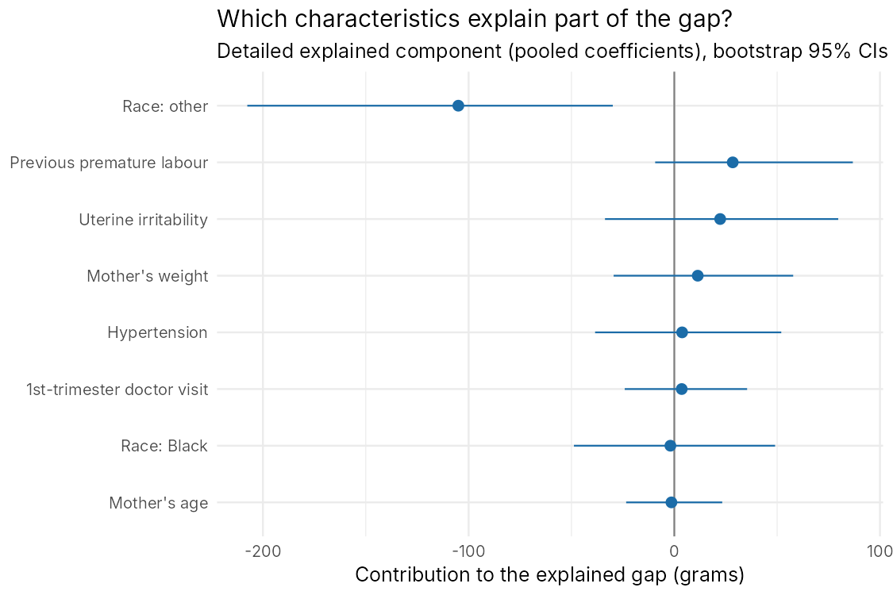

# Blinder-Oaxaca Decomposition of the Birth Weight Gap by Maternal Smoking

Babies of mothers who smoked during pregnancy weigh less at birth. Is that gap explained by differences in the mothers' other characteristics, such as weight, previous premature labour, or prenatal care? Or does it remain after those differences are accounted for? This project answers that with a Blinder-Oaxaca decomposition, a method widely used in health inequality research. The decomposition is coded by hand from its formulas, with bootstrap confidence intervals.

## Question
How much of the birth weight gap between non-smoking and smoking mothers comes from differences in observed characteristics (**explained**), and how much remains (**unexplained**)?

## Data
`birthwt` from the R `MASS` package: 189 births at Baystate Medical Center, Springfield, Massachusetts, in 1986. It includes 115 non-smoking and 74 smoking mothers. The data are public and load inside R.

| | Non-smokers | Smokers |
|---|---:|---:|
| Birth weight (g) | 3,055.7 | 2,771.9 |
| Mother's age (years) | 23.4 | 23.0 |
| Mother's weight (lb) | 130.9 | 128.1 |
| Race: Black | 14% | 14% |
| Race: other | 48% | 16% |
| Hypertension | 6% | 7% |
| Uterine irritability | 13% | 18% |
| Previous premature labour | 10% | 24% |
| 1st-trimester doctor visit | 52% | 39% |

## Methods
Separate linear regressions of birth weight on the covariates are fitted for non-smokers (A) and smokers (B). The mean gap is then split into parts.

**Threefold decomposition**, with group B as the reference:

$$\bar Y_A - \bar Y_B = \underbrace{(\bar X_A - \bar X_B)^\top \hat\beta_B}_{\text{endowments}} + \underbrace{\bar X_B^\top(\hat\beta_A - \hat\beta_B)}_{\text{coefficients}} + \underbrace{(\bar X_A - \bar X_B)^\top(\hat\beta_A - \hat\beta_B)}_{\text{interaction}}$$

**Twofold decomposition** with pooled coefficients $\beta^*$, taken from a pooled model that includes a group indicator (Jann, 2008):

$$\bar Y_A - \bar Y_B = \underbrace{(\bar X_A - \bar X_B)^\top \beta^*}_{\text{explained}} + \underbrace{\bar X_A^\top(\hat\beta_A - \beta^*) + \bar X_B^\top(\beta^* - \hat\beta_B)}_{\text{unexplained}}$$

- **Detailed decomposition:** the explained part is split into the contribution of each covariate.
- **Inference:** a bootstrap stratified by group, with 2,000 resamples. 1,984 were usable. The other 16 had a binary covariate with no variation within one group, such as no hypertensive smokers in the resample.
- **Check:** the code verifies that the components add up exactly to the gap.

## Results

| Component | Grams (95% CI) | % of gap |
|---|---|---:|
| **Total gap** | **283.8 (78.4, 476.8)** | 100 |
| Endowments | 49.1 (-115.0, 217.8) | 17 |
| Coefficients | 330.3 (56.7, 589.8) | 116 |
| Interaction | -95.7 (-345.9, 164.7) | -34 |
| Explained (pooled) | -38.7 (-184.4, 101.6) | -14 |
| Unexplained (pooled) | 322.5 (116.9, 521.1) | 114 |



**Differences in observed characteristics do not explain the gap.** The explained part is close to zero, and its interval includes zero. Almost the whole 284 g gap is unexplained. So smoking mothers are not simply a higher-risk group on the other measured factors.



The detailed decomposition shows why the explained part is slightly negative:
- Some risk factors are more common among smokers, such as previous premature labour, uterine irritability, and fewer early doctor visits. These push the explained gap up a little.
- But mothers in the "other" race group, who have lower birth weights in this sample, are much more common among non-smokers (48% vs 16%). This works in the opposite direction, so non-smokers' characteristics alone would predict *lower*, not higher, birth weights.

**Interpretation.** A large unexplained component agrees with a direct effect of smoking on fetal growth. But it is not proof of causation. The unexplained part also contains the effects of anything not measured, so it is an upper bound on "the effect of the group" under the model. The sample is small, as the wide intervals show.

## How to run
Requires R (4.1 or later) with `MASS` and `ggplot2`.

```bash
Rscript R/analysis.R
```

The bootstrap takes about 10 seconds. The seed is fixed so results can be reproduced exactly. Outputs go to `output/`.

## Repository structure
```
oaxaca-blinder-birthweight/
├── R/analysis.R      # decomposition, bootstrap, figures
├── output/
│   ├── figures/
│   └── tables/
└── README.md
```

## References
- Blinder, A. S. (1973). Wage discrimination: Reduced form and structural estimates. *Journal of Human Resources*, 8, 436–455.
- Oaxaca, R. (1973). Male-female wage differentials in urban labor markets. *International Economic Review*, 14, 693–709.
- Jann, B. (2008). The Blinder-Oaxaca decomposition for linear regression models. *The Stata Journal*, 8, 453–479.
- O'Donnell, O., van Doorslaer, E., Wagstaff, A., & Lindelow, M. (2008). *Analyzing Health Equity Using Household Survey Data*. World Bank. (Chapter 12)
- Hosmer, D. W., & Lemeshow, S. (1989). *Applied Logistic Regression*. Wiley. (Source of the data)

## Author
Tahsina Fariha Ohi, MS Statistics, Ball State University
